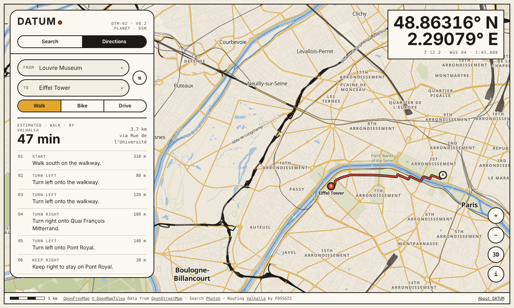
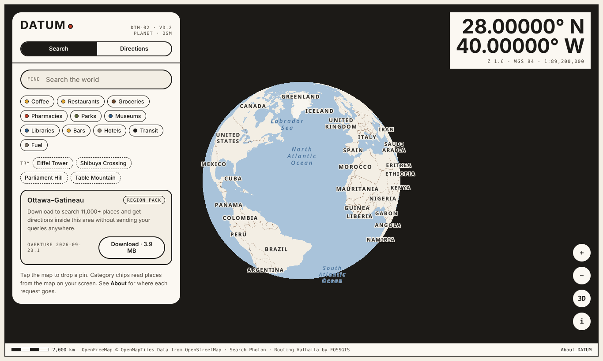
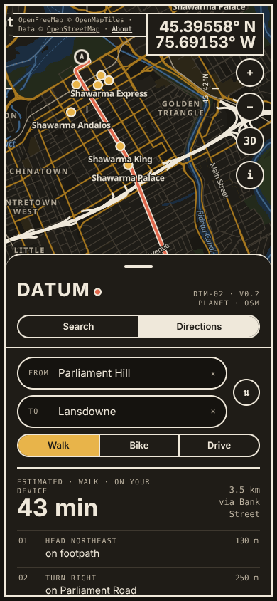
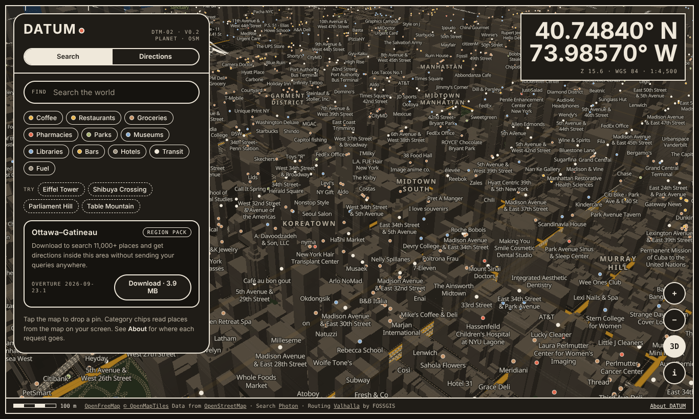

# DATUM Maps

A free, open map of the world. Search places, get walking, cycling and driving
directions, and download **region packs** that search and route on your device
without sending your queries anywhere. No account, no ads, no analytics.

`DTM-02 · v0.2 · build 2026-10-07` — an AI² Lab project by AKA IND Technologies Inc.



| Globe | Region pack on a phone | 3D buildings |
|---|---|---|
|  |  |  |

## What works in v0.2

| Feature | How it works | Where the request goes |
|---|---|---|
| World map (globe at low zoom, 3D buildings) | OpenMapTiles vector tiles rendered with MapLibre GL JS 5.24.0 | OpenFreeMap |
| Search anywhere | Photon geocoder, biased to the map centre | Photon (komoot public server) |
| Directions anywhere (walk, bike, drive) | Valhalla routing with turn-by-turn steps | Valhalla on the FOSSGIS public server |
| World view in the Equal Earth projection | Zoomed out, the world is drawn with d3-geo in Equal Earth, the area-true projection the UN General Assembly backed on 4 September 2026; Natural Earth land, lakes and borders, disputed borders dashed | DATUM's own site (`data/world.json`); d3 loads from cdnjs like MapLibre |
| Category lists (Coffee, Parks, Transit…) | Read from the map tiles already on screen | Nothing sent |
| Ottawa–Gatineau region pack (3.9 MB) | On-device search of 11,487 places and every named street; on-device A* routing over 64,272 road and path segments | Nothing sent after download; stored in the browser's Cache Storage |

## Run it

It is a static site: one `index.html` plus the `packs/` folder. `vercel.json` sets cache and security headers for Vercel; any static host works.

```sh
python3 -m http.server 8080
# open http://localhost:8080
```

Region packs persist through the Cache Storage API, which browsers only expose on
`https://` or `localhost`.

## Services and swapping them

Every external service is in the `CONFIG` block at the top of the script in
`index.html`:

```js
const CONFIG = {
  tiles:  'https://tiles.openfreemap.org/planet',
  glyphs: 'https://tiles.openfreemap.org/fonts/{fontstack}/{range}.pbf',
  search: 'https://photon.komoot.io',
  route:  'https://valhalla1.openstreetmap.de/route',
  packs:  [ /* region packs */ ],
};
```

- **OpenFreeMap** states it is free for any use, with no API keys and no limits on
  map views; attribution is required.
- **Photon** (komoot) public server: free within reasonable use; heavy use is
  throttled or banned; no availability guarantee.
- **Valhalla** on the FOSSGIS server: a community-run public instance. Read the
  FOSSGIS terms at <https://www.fossgis.de/arbeitsgruppen/osm-server/nutzungsbedingungen/>
  before sending real traffic.

All three are open source (OpenFreeMap, Photon, Valhalla) and can be self-hosted.
**Before a public launch with real traffic, point `search` and `route` at our own
instances**; the public servers are not meant to carry another product's load.

## Region packs

A pack is a quantized, delta-encoded JSON extract of Overture Maps data for one
bounding box: a routable road graph (`roads.json`), land, water and neighbourhood
names (`areas.json`) and places (`places.json`).

Build one with `tools/build_pack.py`:

```sh
pip install overturemaps shapely
B=-75.74,45.38,-75.65,45.445
for t in segment place water land_use land division; do
  overturemaps download --bbox=$B -f geojson --type=$t -o raw/$t.geojson
done
python3 tools/build_pack.py        # edit BBOX / RELEASE at the top first; writes pack/*.json
```

Sidewalks are mapped as unnamed footways; the builder gives each one the name of
the parallel street within 30 m (flag 256), so walking directions read
"Bank Street" instead of "footpath". On-device routing snaps endpoints to the
largest strongly connected component for each travel mode, so a route always
exists inside a pack.

Known limits of on-device routing in v0.2: no turn restrictions, no time-based or
partial-length access rules, constant speeds (walk 4.9 km/h, bike 15 km/h, car at
the posted limit or a class default).

## World view

`data/world.json` (152 KB, 50 KB gzipped) is built from Natural Earth, which is in the
public domain, with `tools/build_world.py`:

```sh
pip install shapely
B=https://raw.githubusercontent.com/nvkelso/natural-earth-vector/master/geojson
mkdir -p ne && for f in ne_50m_land ne_50m_admin_0_boundary_lines_land ne_50m_lakes ne_110m_admin_0_countries; do
  curl -sL -o ne/$f.geojson $B/$f.geojson
done
python3 tools/build_world.py ne data/world.json
```

Borders are Natural Earth's de facto lines. Disputed, indefinite and line-of-control
segments are drawn dashed, and countries are not coloured individually. Two de facto
entities that OpenStreetMap does not map as countries (Somaliland, Northern Cyprus) are
left unlabelled for consistency with the rest of the map. The UN's own map images are
not used: the UN website licenses them for personal, non-commercial use only.

## Android app and Android Auto

`android/` builds DATUM for Android, package `ca.akaind.datum` (Android 8 and up).

- **On the phone** it is this web app, bundled in the APK and served to a WebView from
  `https://appassets.androidplatform.net`, a secure origin, so region packs and "locate
  me" work as in a browser. MapLibre GL JS, d3 and the fonts are bundled too
  (`tools/vendor_web.py`, checked against cdnjs's SRI hashes), so the app opens with no
  network and makes no requests to a CDN or to Google. Tiles, search and routing use the
  same servers as the web app. The build copies `index.html`, `data/` and `packs/` from
  the repository root, so the app always ships the current site.
- **In the car** it is a native Android Auto navigation app built on the Car App
  Library 1.7.0. The car screen draws DATUM's own map style (exported from the web app
  by `tools/export_car_style.py`) with MapLibre Native 13.6.1. It has search and five
  nearby categories (gas, EV charging, parking, food, coffee), read from the map tiles
  already on the phone with Photon as the fallback. Route preview offers up to three
  routes from Valhalla. Guidance is turn by turn, with spoken instructions on the
  navigation audio stream, rerouting when the car leaves the route, and arrival. Trip
  details go to the instrument cluster or head-up display where the car has one.
  "Navigate to…" from Assistant and other apps opens DATUM directly. Location comes
  from Android's own location service, with no Google Play services.

Build (JDK 17 or newer, Android SDK 36):

```sh
cd android
./gradlew testDebugUnitTest      # routing, guidance and car screen tests (Robolectric)
./gradlew assembleDebug          # app/build/outputs/apk/debug/app-debug.apk
```

Release builds are signed with the upload key named in `android/keystore.properties`
(or the file `DATUM_KEYSTORE_PROPERTIES` points to). Both that file and the key are
git-ignored and must never be committed. Then:

```sh
./gradlew assembleRelease bundleRelease   # APK to sideload, AAB for Google Play
```

Trying it in a car: Android Auto only lists apps installed from Google Play unless you
turn on Android Auto's developer settings (tap *Version* ten times) and enable *Unknown
sources*. On a computer, Google's Desktop Head Unit stands in for the car. Once
guidance has started, `adb shell dumpsys activity service
ca.akaind.datum/.car.DatumCarAppService AUTO_DRIVE` drives the route for you.

## Attribution (required wherever the map is shown)

- Map: OpenFreeMap © OpenMapTiles. Data from © OpenStreetMap contributors (ODbL 1.0).
- Search: Photon by komoot, OpenStreetMap data.
- Routing: Valhalla, served by FOSSGIS e.V., OpenStreetMap data.
- World view: Natural Earth (public domain), drawn with d3-geo (ISC). Equal Earth projection by Šavrič, Patterson and Jenny (2018).
- Region packs: Overture Maps Foundation (release 2026-09-23.1). Roads, buildings,
  land and water © OpenStreetMap contributors (ODbL 1.0). Places under
  CDLA-Permissive-2.0, including Foursquare Open Source Places (Apache-2.0) and
  AllThePlaces (CC0).

## Licences

- Code: GNU AGPL-3.0 (see `LICENSE`).
- Region pack files: a derivative database of ODbL data, available under ODbL 1.0.
- The Canada address points in Overture (source `ca/countrywide`) are tagged
  `LicenseRef-Proprietary` in the row data, while Overture's documentation lists the
  source as openly licensed. They are left out of packs until that is resolved.
